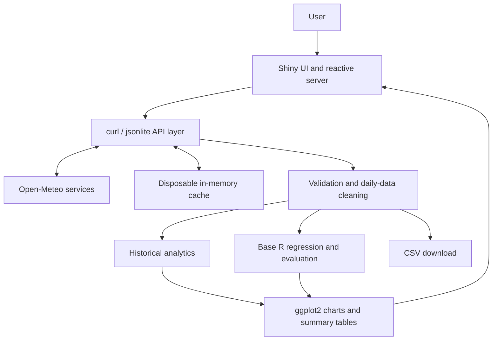
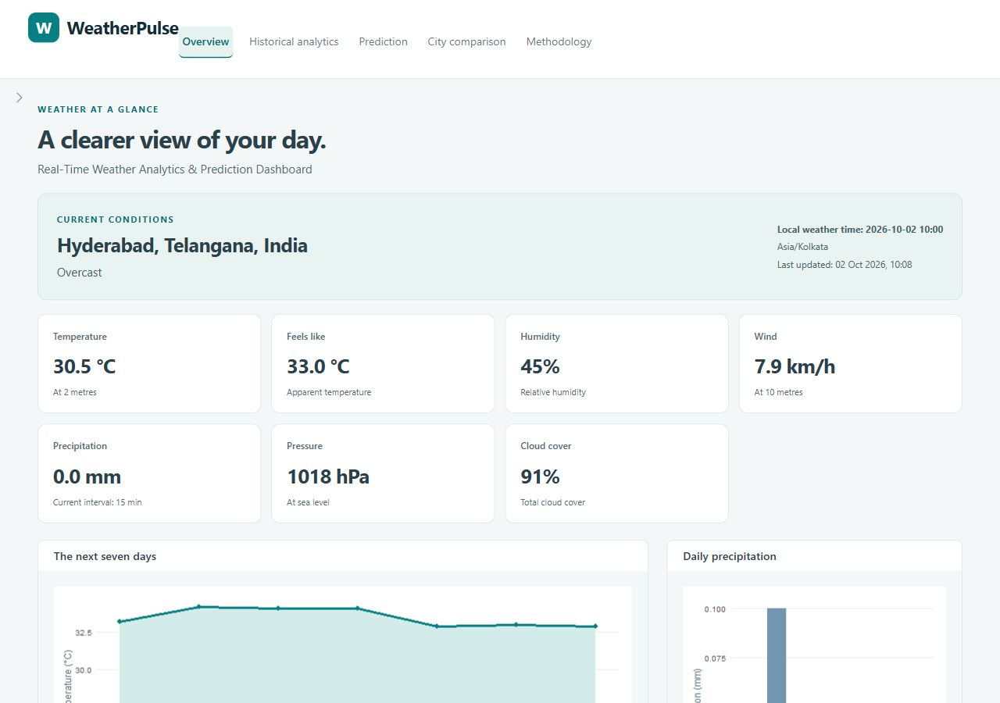
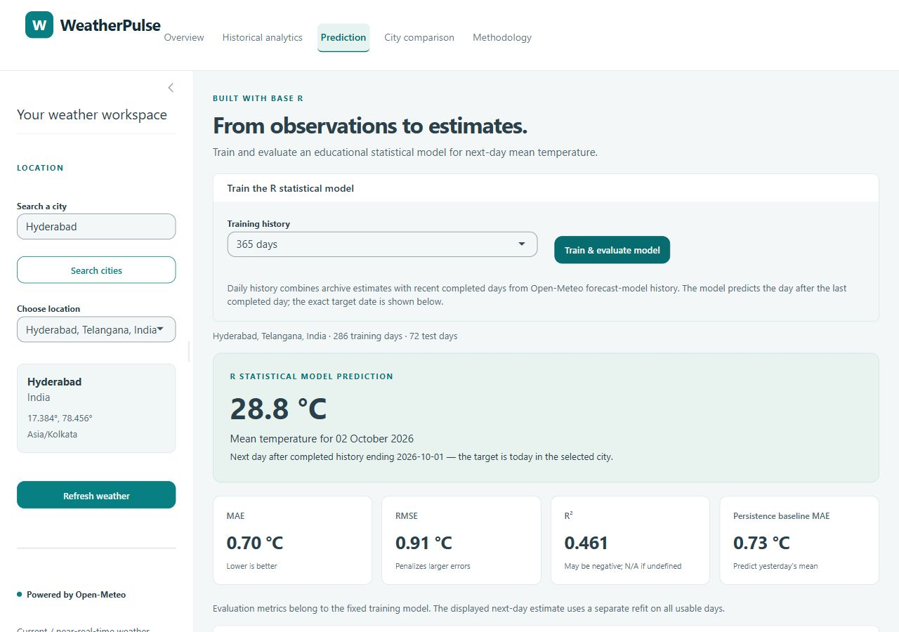

# WeatherPulse

**Real-Time Weather Analytics & Prediction Dashboard using R**

[**Open the live dashboard**](https://sathwik-nagavelli.shinyapps.io/weather-analytics-r/) · [**GitHub repository**](https://github.com/sathwiknagavelli9/weather-analytics-r)

WeatherPulse is an interactive R/Shiny college project that turns real Open-Meteo weather data into current-condition summaries, historical analytics, city comparisons, and an educational statistical temperature prediction. Hyderabad, India is the initial city; users can search for locations worldwide.

The academic project title is **Real-Time Weather Analytics and Prediction Dashboard using R**.

## Features

- Search for cities and distinguish results by administrative region and country.
- View current temperature, feels-like temperature, humidity, precipitation, wind, pressure, cloud cover, and readable weather conditions.
- Refresh weather manually or approximately every five minutes while a Shiny session is active.
- Explore a seven-day forecast with clearly labelled temperature and precipitation charts.
- Request 30, 90, 180, or 365 historical days with a selected end date, inspect summary statistics and charts, and export the loaded records as CSV.
- Train a base R linear regression model for the next daily mean temperature and inspect a chronological holdout evaluation.
- Find and confirm up to three cities, then compare their current weather using an explicit action button.
- Read the methodology, data attribution, and limitations inside the dashboard.

“Real-time” means **current / near-real-time data requested from Open-Meteo during an active session**. The application does not collect sensor data continuously or run permanent background ingestion.

## Technology stack

| Component | Technology |
| --- | --- |
| Language | R |
| Interactive application | Shiny |
| Responsive layout and theme | bslib and custom CSS |
| Charts | ggplot2 |
| HTTP requests | curl |
| JSON decoding | jsonlite |
| Statistical model | Base R `stats::lm()` |
| Deployment | rsconnect and shinyapps.io |
| Version control | Git and GitHub |

The application uses base R for data manipulation and lightweight automated tests. It requires no database or API key. Runtime weather caches are held in memory and can be rebuilt after an application restart.

The validated development runtime was **R 4.5.1** with **shiny 1.14.0**, **bslib 0.12.0**, **ggplot2 4.0.3**, **curl 8.0.0**, **jsonlite 2.0.0**, and **rsconnect 1.11.1**. These are the versions checked during development, rather than a promise that later package releases produce identical results.

## Architecture



| File or directory | Responsibility |
| --- | --- |
| `app.R` | Application UI, reactive interactions, and presentation |
| `R/api.R` | Requests, retries, geocoding, weather parsing, and caching |
| `R/analytics.R` | Historical transformation, summaries, and aggregation |
| `R/prediction.R` | Time-series features, model fitting, evaluation, and next-day prediction |
| `R/weather_codes.R` | WMO weather-code descriptions |
| `R/utils.R` | Shared formatting and validation helpers |
| `www/styles.css` | Responsive visual styling |
| `scripts/` | Dependency installation, automated checks, smoke test, and deployment |
| `tests/` | Offline module tests and Shiny server integration tests using deterministic fixtures |
| `docs/` | Academic report, viva notes, and captured dashboard screenshots |

## Data source and provenance

The API layer calls the following public Open-Meteo services:

- [Geocoding API](https://open-meteo.com/en/docs/geocoding-api): resolve city names to coordinates and location metadata.
- [Weather Forecast API](https://open-meteo.com/en/docs): current conditions, seven-day forecast, and recent daily weather.
- [Historical Weather API](https://open-meteo.com/en/docs/historical-weather-api): historical daily temperatures, precipitation, and wind.

Weather requests use city-local time with `timezone=auto`. Open-Meteo provides model-based and reanalysis weather products; the values should not be described as direct readings from a local sensor owned by this project. Current-condition timestamps and retrieval timestamps have different meanings: one identifies the weather time supplied by the provider, and the other records when the application fetched it.

Historical archive data can lag the present. For model training through the most recent completed local day, the application combines an archive segment with recent completed daily data from the forecast service. The current incomplete day is excluded from the training history. This combines provider products and is disclosed as a limitation.

The Historical Analytics tab uses the archive alone: its selected end date must be at least six days before the current date in the selected city. It initially offers a 90-day window and can load 30, 180, or 365 days instead. The model's 180-day and 365-day options use archive records through local today minus six days, followed by the five most recent completed days from forecast-model history. CSV exports retain data-source and mean-temperature-method labels, along with location and units in column names.

Weather data is attributed to **[Open-Meteo](https://open-meteo.com/)**. Consult its [data licence and attribution terms](https://open-meteo.com/en/license) before reusing downloaded data. The MIT licence in this repository applies to the project code, not to third-party weather data.

## Prediction methodology

The **R Statistical Model Prediction** is produced by this project's R code. It is distinct from Open-Meteo's forecast.

1. Obtain 180 or 365 days of historical daily weather and order records by date; 365 days is the default.
2. Use daily mean temperature; when unavailable, use `(maximum + minimum) / 2` and disclose the approximation.
3. Build temperature features for the previous one, two, and three days, the mean of the previous seven days, and sine/cosine terms for the target date's day of year.
4. Remove rows without complete usable predictors and require at least 90 usable model rows. A complete final seven-day history is required for the next prediction.
5. Use the earliest approximately 80% of eligible rows for training and the latest approximately 20% for testing. Never shuffle the dates.
6. Select varying, linearly independent predictors using only the training data, fit an ordinary least-squares regression with `stats::lm()`, and evaluate it on the held-out dates.
7. Refit using all eligible completed-day data to estimate the following day's mean temperature.

The holdout measures **one-day-ahead predictions using actual prior-day provider values**. Later test predictions use earlier actual test values as lag inputs. This retrospective evaluation treats those earlier values as known; it does not reconstruct the exact data releases available on each historical prediction date. This matters because reanalysis can be delayed or revised. It is not a recursive multi-day forecast.

The target date is always displayed. History ends yesterday, so the next-day target is **today in the selected city's timezone**, not tomorrow. The seven-day Open-Meteo forecast appears in Overview, while the Prediction tab displays the separate R model estimate. Compare two values only when their target dates match.

### Evaluation metrics

| Metric | Meaning | Interpretation |
| --- | --- | --- |
| MAE | Mean absolute prediction error | Average error magnitude in °C; lower is better |
| RMSE | Square root of mean squared error | Error magnitude in °C with greater weight on large misses; lower is better |
| R² | `1 - sum((actual - predicted)^2) / sum((actual - mean(actual))^2)` | Holdout skill relative to its mean; may be negative |

R² is shown as N/A if the actual holdout values have no meaningful variation. Training and testing sample sizes refer to usable feature rows, so they are smaller than the raw number of daily records. Metrics vary with city, date range, provider revisions, and data completeness. They are not a guarantee of future accuracy.

The model also calculates a **persistence baseline**, which predicts that the next daily mean will equal the previous day's mean. Its holdout errors provide a simple comparison: regression complexity is useful only when supported by the measured result.

### Measured Hyderabad example

The real-data smoke test passed on **2 October 2026 at 10:04 IST (04:34 UTC)** for **Hyderabad, Telangana, India**. It loaded **2 October 2025 through 1 October 2026**: 365 daily rows, with **286 training rows and 72 test rows** after lag construction.

| Model | Holdout MAE (°C) | Holdout RMSE (°C) | Holdout R² |
| --- | ---: | ---: | ---: |
| R linear regression | 0.699 | 0.913 | 0.461 |
| Previous-day persistence | 0.725 | 0.914 | 0.460 |

The refitted regression estimated **28.78 °C** for the mean temperature on **2 October 2026**, the day after the completed history. The regression's holdout errors were slightly smaller than the persistence baseline in this run. This is a measured snapshot of one city and evaluation period, not a general accuracy claim or a validated outcome for the target date. Repeating the smoke test can produce different values as time advances or provider data is revised.

## Install and run locally

Install R on Windows and make `Rscript` available in your terminal, or use the executable from your own R installation. The validated development runtime is R 4.5.1. Open a terminal in this repository, then run:

```powershell
Rscript scripts/install_dependencies.R
Rscript scripts/run_tests.R
Rscript scripts/smoke_test.R
Rscript -e "shiny::runApp('.', host = '127.0.0.1', port = 3838, launch.browser = FALSE)"
```

Open [the local dashboard](http://127.0.0.1:3838) while that final command is running. Stop it with Ctrl+C. An internet connection is required for weather requests and package installation.

The dependency installer checks existing packages, prefers Windows binaries, and retries alternative CRAN mirrors when needed. It also provides a Windows download fallback for intermittent R HTTPS download failures. Rtools is not required for the intended binary installation workflow.

## Verification

`scripts/run_tests.R` runs offline checks for API parsing, geocoding, weather-code mapping, historical transformation, lag features, regression, metrics, and insufficient-data handling. It also runs `tests/test_server.R`, which uses Shiny's `testServer()` to exercise city selection, refresh, history actions, the actual CSV download handler, model execution, comparison, and recovery from failed requests. These server tests use deterministic service substitutes and make no external weather calls. Simulated data belongs only to the tests; production requests always use Open-Meteo.

`scripts/smoke_test.R` checks package availability and makes real weather requests before exercising historical processing and the statistical model. It needs internet access. A service interruption can fail this integration check even when the offline tests pass.

During development, **all offline tests passed**, including the Shiny server integration tests. The real-data smoke test also passed with the measured results above. A separately launched local Shiny process returned **HTTP 200 with HTML**, and its CSS asset returned **HTTP 200**.

Interactive local browser checks also passed on 2 October 2026:

- Hyderabad loaded initially with current conditions, seven daily forecast records, and rendered charts.
- A 90-day historical request rendered its summaries and three charts. A browser-downloaded CSV contained 90 records with source, mean-temperature method, location, and unit-labelled columns.
- The R model trained and displayed its target date, measured errors, sample sizes, and holdout chart.
- Hyderabad, London, and Tokyo loaded in city comparison. A separate London search worked, and an unknown-city search displayed a friendly notification while retaining London's loaded result.
- At 1280-pixel desktop and 390-pixel mobile widths, the page had no horizontal overflow. Mobile navigation worked, and the location sidebar could be opened and collapsed.

The public GitHub repository was pushed successfully on branch `main`, and shinyapps.io deployment completed successfully on 2 October 2026. The public application returned **HTTP 200 with HTML**. A hosted browser session loaded Hyderabad's current conditions, seven forecast days and charts, and 90 historical days with summaries, a table, and three charts. It completed **Train & evaluate model** with 286 training rows, 72 test rows, the 2 October target, and metrics consistent with the measured smoke-test result. Hosted logs confirmed startup under R 4.5.1 with no runtime errors in the inspected output, and the checked browser console contained no errors. These checks confirm that the deployed R application can reach Open-Meteo and execute its model.

## Screenshots

Captured from the running application on 2 October 2026. Weather values reflect the capture time. The images below show local verification; the [hosted overview](docs/screenshots/live-overview.jpg) and [hosted prediction](docs/screenshots/live-prediction.jpg) screenshots record the verified public deployment.

**Overview — Hyderabad current conditions and forecast**



**Prediction — R model estimate and measured holdout metrics**



[View the mobile location sidebar screenshot](docs/screenshots/mobile.jpg).

## Deployment

The deployment script uses the existing local rsconnect account configuration. It does not contain authentication secrets.

```powershell
Rscript scripts/deploy.R
```

The published application runs under shinyapps.io account `sathwik-nagavelli` with app name `weather-analytics-r`. Its [public dashboard](https://sathwik-nagavelli.shinyapps.io/weather-analytics-r/) and real-data model execution were verified on 2 October 2026. The source is available in the public [sathwiknagavelli9/weather-analytics-r repository](https://github.com/sathwiknagavelli9/weather-analytics-r) on branch `main`.

The deployment bundle includes only `app.R`, the R modules, and `www/` assets. Documentation, screenshots, test fixtures, temporary results, and local account configuration are excluded. The optional `WEATHERPULSE_APP_NAME` environment variable selects a different app name for an intentional alternate deployment.

Deployment requires a locally authenticated rsconnect account. Do not place authentication tokens in source files, `.Renviron`, documentation, or Git. The app uses only relative project paths and retrieves weather data again after a fresh process starts. A free hosted application can sleep when inactive, so the first visit may take longer to load.

## Demonstration walkthrough

1. Open the dashboard with Hyderabad selected and explain the weather timestamp, units, and source.
2. Search for another city and select the correct region and country.
3. Inspect the forecast chart and explain that it comes from Open-Meteo.
4. Select a history length and end date, click **Analyze historical data**, discuss temperature and precipitation trends, and download the CSV.
5. Train the R model, read its displayed target date, and explain the chronological split and holdout errors.
6. Enter city names, click **Find cities**, confirm each region and country, then click **Compare weather**. Discuss why local weather timestamps may differ.
7. Use the methodology page to explain limitations and the application architecture.

## Limitations

- This is an educational statistical prediction system, not a professional meteorological forecasting service.
- External API availability, quotas, freshness, and model revisions affect the dashboard.
- Recent and older history can come from different Open-Meteo products; provider daily values are not an independent ground-truth sensor dataset.
- Linear temperature features cannot capture every nonlinear weather process or rare extreme.
- Holdout evaluation covers one period for one selected location and uses actual prior observations.
- The service does not continuously ingest data while no user session is active.
- This project demonstrates the analytics lifecycle on a manageable weather dataset; it does not implement a distributed big-data processing platform.

## Future enhancements

Useful extensions include rolling-origin evaluation across multiple seasons, interval calibration, additional validated weather predictors, and broader accessibility testing. More complex models should be justified by measured improvements against the included persistence baseline and by hosting costs.

## Academic documentation

- [Project report](docs/PROJECT_REPORT.md)
- [Viva notes: 25 questions and answers](docs/VIVA_NOTES.md)
- [MIT licence](LICENSE)

## Credits

Weather data and geocoding: Open-Meteo. Application framework: the Shiny and bslib maintainers. Visualization: ggplot2. HTTP and JSON libraries: curl and jsonlite. Statistical modelling: R and its `stats` package.
