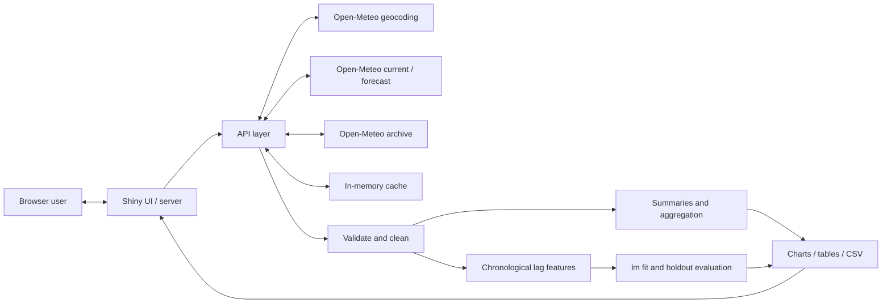

# Real-Time Weather Analytics and Prediction Dashboard using R

**Application name:** WeatherPulse

**Project type:** R programming / analytics college project

**Primary data provider:** Open-Meteo

## Abstract

WeatherPulse is an interactive application for exploring current weather, short-range forecasts, historical patterns, and an educational next-day mean-temperature model. It is implemented in R using Shiny, bslib, ggplot2, curl, and jsonlite, with deployment supported by rsconnect and shinyapps.io. Public Open-Meteo services supply real location and weather data without an application API key. The system demonstrates the full analytics lifecycle: acquisition, validation, cleaning, feature construction, exploratory analysis, model fitting, evaluation, visualization, and user interaction. A base R linear regression uses recent temperature history and seasonal features. Its performance is assessed with a chronological holdout and reported through MAE, RMSE, and R² when valid. In-memory caching and explicit action buttons reduce avoidable network and computation costs. The project is designed for academic demonstration and does not claim meteorological-grade prediction or distributed large-scale processing.

## 1. Introduction

Weather is an accessible example of data that varies with both location and time. A dashboard can make these variations easier to understand by connecting numerical summaries with charts and location-aware timestamps. A useful analytical application must do more than display data: it must validate external responses, preserve units and dates, handle missing observations, and explain how any predictions were produced.

WeatherPulse uses Hyderabad, India as the default demonstration city, while supporting location searches worldwide. It separates three different outputs: current / near-real-time provider weather, the provider's forecast, and an educational statistical prediction created by the application's own R code.

## 2. Problem statement

General weather pages provide convenient current conditions and forecasts, but they do not necessarily expose the acquisition, preprocessing, model construction, and evaluation steps needed for an R programming project. Students need a compact, inspectable system that joins these steps and presents their results clearly.

The project therefore addresses this question: how can a lightweight R application acquire real weather data, transform it into useful analyses, and demonstrate a defensible statistical prediction workflow through an interactive web interface?

## 3. Objectives

1. Resolve worldwide city names to unambiguous coordinates and location metadata.
2. Present current conditions and a seven-day external forecast with clear units and timestamps.
3. Fetch, clean, summarize, visualize, and export historical daily weather.
4. Implement an actual next-day mean-temperature model using base R.
5. Evaluate predictions with a chronological holdout and meaningful error metrics.
6. Compare up to three cities using consistent weather variables.
7. Handle network, data, and model failures without crashing the complete dashboard.
8. Support a reproducible local workflow and lightweight shinyapps.io deployment.
9. Describe the system's evidence, limits, and third-party data source accurately.

## 4. Existing system and motivation

Weather provider interfaces are designed primarily for weather consumption. A teaching application has an additional need: to make the relationship between source data, transformations, evaluation, and output visible. A basic static chart also lacks the location search, dynamic filtering, prediction execution, and failure handling expected from an interactive project.

WeatherPulse integrates those capabilities in a small R codebase. Its contribution is the software and analytics workflow rather than a new meteorological data source or a new regression algorithm.

## 5. Proposed system

The user selects a location in the dashboard. The API layer resolves coordinates, requests real weather data, and validates the response. Cleaned records feed either descriptive analytics or model feature construction. Shiny updates summary cards, tables, and ggplot2 charts in response to completed actions. Historical records can be downloaded as CSV.

Current conditions refresh on demand and approximately every five minutes during an active session. Historical acquisition, city comparison, and model training use explicit user actions to avoid costly requests on every edit. Temporary in-memory caches reuse recent responses. They are an optimization rather than permanent storage.

## 6. Technology stack

| Technology | Role and rationale |
| --- | --- |
| R | Statistical programming, data handling, and an inspectable academic implementation |
| Shiny | Reactive web interface written in R |
| bslib | Responsive layout and consistent visual theme |
| ggplot2 | Labelled temperature, precipitation, comparison, and evaluation charts |
| curl | HTTP requests with explicit status and timeout handling |
| jsonlite | Parsing JSON responses into R structures |
| Base R `stats` | Ordinary least-squares regression through `lm()` |
| rsconnect | Bundling and deploying the Shiny application |
| shinyapps.io | Hosted Shiny runtime |
| Git and GitHub | Source control and portfolio distribution |

No database is required. The implementation avoids large modelling frameworks and distributed processing infrastructure because the daily datasets are small enough for ordinary R memory and computation.

The checked development environment used R 4.5.1, shiny 1.14.0, bslib 0.12.0, ggplot2 4.0.3, curl 8.0.0, jsonlite 2.0.0, and rsconnect 1.11.1.

## 7. System architecture



The browser handles interaction and presentation; R performs API calls, data preparation, and modelling. API credentials are unnecessary for the public data services used here. Deployment authorization is stored locally by rsconnect and is kept outside source control.

## 8. Modules

| Module | Responsibility |
| --- | --- |
| `app.R` | Compose the dashboard and connect reactive inputs to outputs |
| `R/api.R` | Construct requests, retry temporary failures, validate HTTP/JSON responses, and parse locations and weather |
| `R/analytics.R` | Transform daily records and calculate summaries and aggregations |
| `R/prediction.R` | Generate lag and seasonal features, fit the model, calculate errors, and produce the next target prediction |
| `R/weather_codes.R` | Convert WMO codes to readable weather descriptions |
| `R/utils.R` | Shared helpers and formatting |
| `www/styles.css` | Dashboard appearance and responsive adjustments |
| `scripts/` and `tests/` | Installation, checks, integration smoke test, and deployment |

## 9. Data source

Open-Meteo provides geocoding, current weather and forecasts, and historical weather endpoints. Requested variables include daily minimum, maximum, and mean temperature, precipitation, and maximum wind speed, together with current-condition fields.

Open-Meteo products include numerical model output and reanalysis. Consequently, historical values used as model targets should be called provider values rather than independent local sensor observations. Geographic model resolution and data-product revisions can affect the results.

Weather requests use `timezone=auto`. A calendar day is interpreted in the selected city's timezone. This is essential when a user in one country studies weather in another country.

## 10. Data acquisition

The API layer uses curl to send requests and jsonlite to decode responses. It checks HTTP status, handles timeouts and malformed JSON, retries eligible transient failures with backoff, and converts failures into readable messages. Empty geocoding results do not produce invented locations.

Historical archives can have a publication delay. The prediction history combines archive data through an earlier cutoff with recent completed-day records from the forecast service. It excludes the current incomplete local day. This allows a forecast target immediately after the most recent completed day while acknowledging that the training history spans different provider products.

Historical Analytics offers 30-, 90-, 180-, and 365-day windows and a selectable end date. The end date is restricted to at least six days before the selected city's current local date, and the initial window is 90 days. Model training offers 180 or 365 days, with 365 selected by default. Its archive segment ends at local today minus six days, followed by the five most recent completed days from forecast-model history.

No fake weather values are used as a production fallback. If acquisition fails, the affected action reports an error. Failed refreshes preserve the same city's last successful current conditions and display an error notice. Failed historical or model actions preserve their prior successful result. Changing the selected city clears the previous city's weather, history, and model results.

## 11. Data preprocessing

Preprocessing checks required response structures, aligns daily arrays, parses dates, converts numerical fields, handles missing values, and orders records chronologically. Missing optional fields remain unavailable rather than silently becoming zero. API parsing rejects invalid or repeated daily dates, and the cleaning helper can retain the last record when a supplied data frame contains duplicate dates. Feature construction uses a daily calendar grid, so absent dates remain gaps rather than becoming incorrect adjacent-day lags.

Daily mean temperature is taken from the provider when usable. Otherwise, a midpoint estimate can be calculated as:

`mean_temperature = (maximum_temperature + minimum_temperature) / 2`

This midpoint is an approximation: it is not necessarily equal to the average of all temperatures measured throughout a day. The fallback is reported instead of being presented as an exact provider mean.

Cleaning preserves the data-source and mean-temperature-method columns. CSV downloads include those labels, location details, and measurement units in column names, allowing an exported result to be interpreted outside the application.

Feature construction uses previous calendar days. Initial rows without sufficient preceding history are unusable for the regression. Gaps and missing measurements can remove additional rows; sample-size reporting therefore refers to the final eligible feature dataset.

## 12. Exploratory analytics

Historical summaries include average temperature, maximum and minimum temperature, total precipitation, the rainiest day, rainy-day counts, and wind summaries when available. Temperature is measured in °C, precipitation in mm, and wind speed in km/h. The average-wind statistic is specifically the mean of daily maximum wind speeds; it is not an average across all hours. Coverage counts indicate how many usable temperature and precipitation values support the summaries.

Daily temperature charts reveal variation over the selected period. Precipitation charts highlight rainfall timing and intensity. Monthly aggregation can provide a broader view when enough data exists. A month that is only partly covered by the selected range is a partial-month summary, so its precipitation total should not be compared casually with a complete month.

The dashboard provides descriptive analytics. Associations visible in the charts do not by themselves establish causation or a climate trend.

## 13. Prediction methodology

### 13.1 Prediction target

The target is the next daily mean temperature after the most recent completed day in the training data. The dashboard displays the actual target date. When history ends yesterday, the target is today in the selected city's timezone. It should not automatically be described as tomorrow's temperature.

### 13.2 Predictors

For target date `t`, predictors are:

- Mean temperature on `t - 1`, `t - 2`, and `t - 3`.
- The mean temperature across the seven days before `t`.
- `sin(2 * pi * day_of_year(t) / 365.25)`.
- `cos(2 * pi * day_of_year(t) / 365.25)`.

Lagged temperatures capture short-term persistence. The preceding seven-day mean describes recent background conditions. The sine and cosine terms provide a smooth annual seasonal representation and avoid treating the end of December and the start of January as unrelated extremes.

### 13.3 Model

The regression has the general form:

`temperature(t) = intercept + b1*lag1 + b2*lag2 + b3*lag3 + b4*previous7_mean + b5*season_sin + b6*season_cos + error`

The coefficients are estimated with ordinary least squares through `stats::lm()`. The model is intentionally lightweight, interpretable, and easy to host. At least 90 complete feature rows are required by default, and the final seven consecutive daily temperatures must be valid. Constant and linearly dependent predictors are excluded using the training data alone. The code checks fit validity and handles unsuitable data, singular fits, and invalid predictions without terminating the entire application.

## 14. Train/test strategy

The earliest approximately 80% of usable feature rows form the training set. The remaining latest approximately 20% form the test set. Records are never randomly shuffled.

Random shuffling would mix earlier and later weather regimes and make it harder to interpret performance as a forecast into a later period. A chronological split preserves time direction, although a single split still represents only one historical evaluation window.

The fitted training model predicts each held-out day using that day's actual preceding provider temperatures. An actual value from an earlier test day can therefore become a predictor for a later test day. This is a one-step-ahead evaluation with historical values, not a multi-step simulation that repeatedly feeds predictions back into the model. It is retrospective: it uses the history currently returned by the provider rather than reconstructing exact as-issued datasets. Reanalysis delays and revisions therefore limit how closely it represents historical operational forecasts.

After evaluation, a separate final fit uses all eligible completed-day records to create the next prediction. Test metrics remain associated with the training-only fit; they are not in-sample scores from the final refit.

## 15. Evaluation metrics

Let `y_i` be the actual provider daily mean and `p_i` the predicted mean for each of `n` test records.

| Metric | Formula | Meaning |
| --- | --- | --- |
| MAE | `mean(abs(y - p))` | Average absolute error in °C |
| RMSE | `sqrt(mean((y - p)^2))` | Error in °C with more emphasis on large mistakes |
| R² | `1 - sum((y - p)^2) / sum((y - mean(y))^2)` | Performance relative to a constant test-mean reference |

Lower MAE and RMSE indicate smaller errors over the evaluated period. R² may be negative on holdout data. It is not an accuracy percentage, and it is unavailable when the denominator has no meaningful variation. The dashboard also reports training and testing sample counts so that readers can judge the amount of supporting data.

The implementation additionally computes persistence-baseline errors on the same test records. This baseline predicts the target day's mean using only the previous day's mean. It provides a useful simple benchmark; a regression should not be called better merely because it is more complex.

## 16. Dashboard features

| Section | User-facing outputs |
| --- | --- |
| Overview | City identity, timezone, timestamps, current-condition cards, and external forecast charts |
| Historical Analytics | History-length and end-date selection, coverage counts, summary statistics, daily/monthly charts, and CSV export |
| Prediction | R model target date and estimate, error metrics, sample sizes, and actual-versus-predicted holdout plot |
| City Comparison | Find cities, confirm region/country matches, and compare a current-condition table and temperature chart for up to three cities |
| About / Methodology | Data source, architecture, model explanation, real-time definition, and limitations |

Explicit buttons control expensive actions. Missing data and request failures produce readable feedback. The dashboard labels provider forecasts and R model predictions separately to prevent confusion about their origin.

## 17. Testing and reproducibility

The project uses lightweight base R tests and deterministic fixtures. Fixtures are limited to automated testing and never replace production weather data.

| Test area | Intended evidence |
| --- | --- |
| API and geocoding parsing | Valid structures parse correctly; malformed, empty, or incomplete structures fail clearly |
| Weather-code mapping | Known codes have readable labels; unsupported or missing codes are handled |
| Historical transformation | Dates and numerical fields remain aligned; missing values are handled |
| Feature construction | Lags and previous-seven-day means do not use the target day's value |
| Model and metrics | Chronological splits, valid model output, MAE, RMSE, and R² behavior |
| Defensive behavior | Insufficient or unsuitable data produces a controlled failure |
| Shiny server integration | Deterministic `testServer()` checks for location selection, refresh, explicit history actions, CSV content, model execution, city comparison, and failure recovery |
| Real-data smoke test | Required packages load and actual Open-Meteo data passes acquisition and modelling checks |
| Local launch | A background Shiny process starts and returns an HTML page |
| Browser verification | Visible outputs and user actions work in a running session |
| Deployment verification | Published application responds and can retrieve provider data |

Reproduction commands from the repository root are:

```powershell
Rscript scripts/install_dependencies.R
Rscript scripts/run_tests.R
Rscript scripts/smoke_test.R
Rscript -e "shiny::runApp('.', host = '127.0.0.1', port = 3838, launch.browser = FALSE)"
```

The deployment script is `scripts/deploy.R` and relies on existing local rsconnect authorization. Authentication secrets must never be embedded in source code or included in the repository.

The server tests substitute only the external data services; they execute the application's actual reactive server and CSV handler. They establish server behavior independently of the network, while a rendered browser session remains necessary to inspect client interaction and visual presentation. The production deployment bundle is restricted to `app.R`, the R modules, and `www/` assets; tests, documentation, screenshots, and temporary verification results are excluded.

## 18. Results and interpretation

The application produces location-specific current-condition summaries, provider forecast plots, historical summaries, CSV exports, city comparisons, and a separate R regression estimate. The exact contents depend on the provider response and the selected city and period.

### 18.1 Measured default-city run

The real-data smoke test completed successfully on **2 October 2026 at 10:04 IST (04:34 UTC)**. It resolved **Hyderabad, Telangana, India**, retrieved current weather and the seven-day forecast, processed daily history, calculated historical summaries, and trained and evaluated the regression.

| Run detail | Measured value |
| --- | --- |
| Historical period | 2 October 2025–1 October 2026 |
| Raw daily records | 365 |
| Usable feature rows | 358 |
| Chronological training rows | 286 |
| Chronological testing rows | 72 |
| Regression MAE | 0.699422 °C |
| Regression RMSE | 0.913283 °C |
| Regression R² | 0.460814 |
| Persistence baseline MAE | 0.725000 °C |
| Persistence baseline RMSE | 0.914087 °C |
| Persistence baseline R² | 0.459864 |
| Final prediction target | 2 October 2026, Hyderabad local date |
| Full-history refit estimate | 28.78 °C daily mean |

The regression achieved slightly lower MAE and RMSE than the previous-day persistence baseline over this holdout. This measured improvement is specific to this city and period. It does not establish reliability across other seasons, climates, or locations. The target-day estimate is a prediction, and this run does not validate it against a completed target-day outcome. R² is not a percent-accuracy measure.

### 18.2 Operational evidence

All offline tests passed, including the Shiny server integration checks for selection, refresh, historical actions, CSV content, model execution, comparison, and failure recovery. The real-data smoke test also passed. A separately launched local Shiny application returned HTTP 200 with an HTML page, and its CSS asset returned HTTP 200.

Local browser verification on 2 October 2026 confirmed the initial Hyderabad result, current conditions, seven-day forecast records, and rendered charts. Historical Analytics loaded 90 days and displayed three charts. The browser-downloaded CSV contained 90 records with data-source, mean-temperature-method, location, and unit-labelled columns. The Prediction action produced the model result, holdout errors, sample counts, and evaluation chart. City Comparison loaded Hyderabad, London, and Tokyo. An independent London search worked, and an unknown-city search produced a friendly notification without replacing the loaded London result.

Responsive checks at 1280-pixel desktop and 390-pixel mobile widths found no page-level horizontal overflow. Mobile navigation worked, and the location sidebar could be opened and collapsed. Captured evidence is available in the [overview screenshot](screenshots/overview.jpg), [prediction screenshot](screenshots/prediction.jpg), and [mobile screenshot](screenshots/mobile.jpg).

These results establish local startup, tested server behavior, real-data integration, and browser workflows. Public-host verification remains a separate check after publication.

### 18.3 Reproducibility limits

Repeating the run can change its inputs and results as the local date advances or provider values are revised. Preserve the location, retrieval date, historical range, target date, train/test counts, and measured metrics together when reporting results. A screenshot demonstrates the displayed result at capture time; it does not establish repeatable accuracy elsewhere. Deployment success requires a successful publication and a checked public URL, rather than only the existence of deployment code.

## 19. Limitations

1. The regression is an educational statistical model and cannot reproduce a professional weather simulation.
2. Open-Meteo availability, response limits, freshness, and revisions are external dependencies.
3. Provider model/reanalysis targets are not independent sensor measurements; recent and archive data can have different provenance.
4. A single chronological split offers limited evidence across seasons and locations.
5. A linear relationship may miss nonlinear processes, rapid changes, and rare extremes.
6. Missing days or low-variance data can make a model unsuitable for training.
7. Automatic refresh occurs only while a session is active; there is no permanent background sensor ingestion.
8. In-memory caching is lost after a restart and must not be treated as durable storage.
9. Free hosted instances can sleep and have limited resources.
10. This is a small-to-moderate daily-data analytics application, not a distributed big-data processing system.

## 20. Future scope

Potential improvements include evaluating multiple rolling-origin windows, checking interval coverage, adding well-validated meteorological predictors, and testing more locations and climates. Any model extension should be assessed against the included previous-day persistence baseline. Accessibility reviews and richer data-quality summaries would also improve usability. Persistent storage or complex models should be introduced only when a clear requirement justifies the additional operational cost.

## 21. Conclusion

WeatherPulse provides an inspectable R implementation of the weather analytics lifecycle, combining real external data with interactive descriptive analysis and an independently implemented regression workflow. Chronological evaluation, explicit data provenance, clear prediction dates, and controlled failures are essential to the project's credibility. Its academic value lies in demonstrating a complete analytical application while keeping its statistical and operational claims proportionate to the evidence.

## 22. References

1. [R Project for Statistical Computing](https://www.r-project.org/).
2. [Shiny documentation](https://shiny.posit.co/).
3. [bslib documentation](https://rstudio.github.io/bslib/).
4. [ggplot2 documentation](https://ggplot2.tidyverse.org/).
5. [Open-Meteo Weather Forecast API](https://open-meteo.com/en/docs).
6. [Open-Meteo Geocoding API](https://open-meteo.com/en/docs/geocoding-api).
7. [Open-Meteo Historical Weather API](https://open-meteo.com/en/docs/historical-weather-api).
8. [Open-Meteo licence and attribution](https://open-meteo.com/en/license).
9. [rsconnect documentation](https://rstudio.github.io/rsconnect/).
10. [shinyapps.io user guide](https://docs.posit.co/shinyapps.io/guide/).
